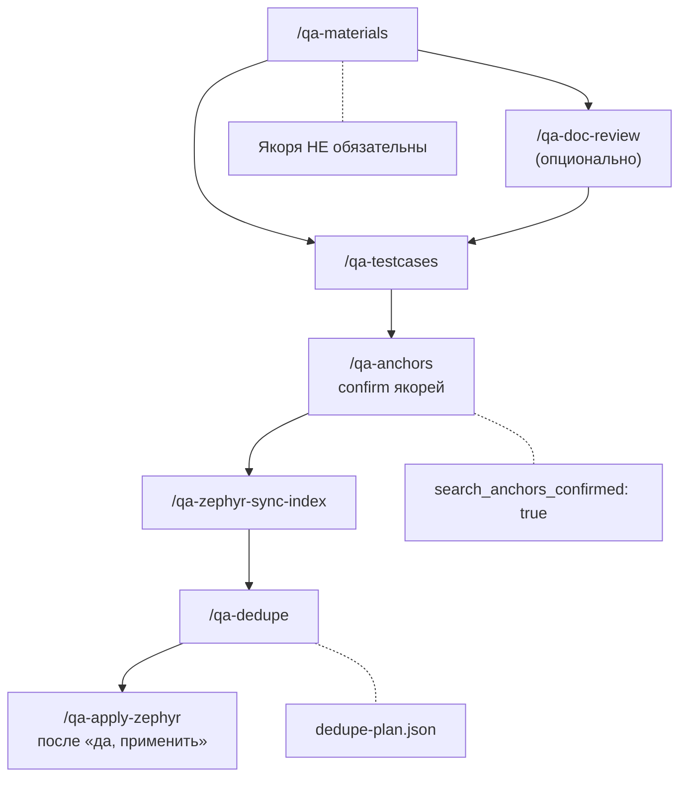
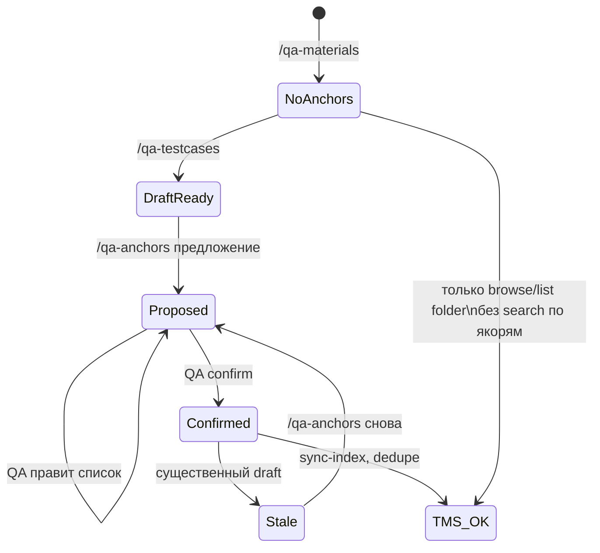
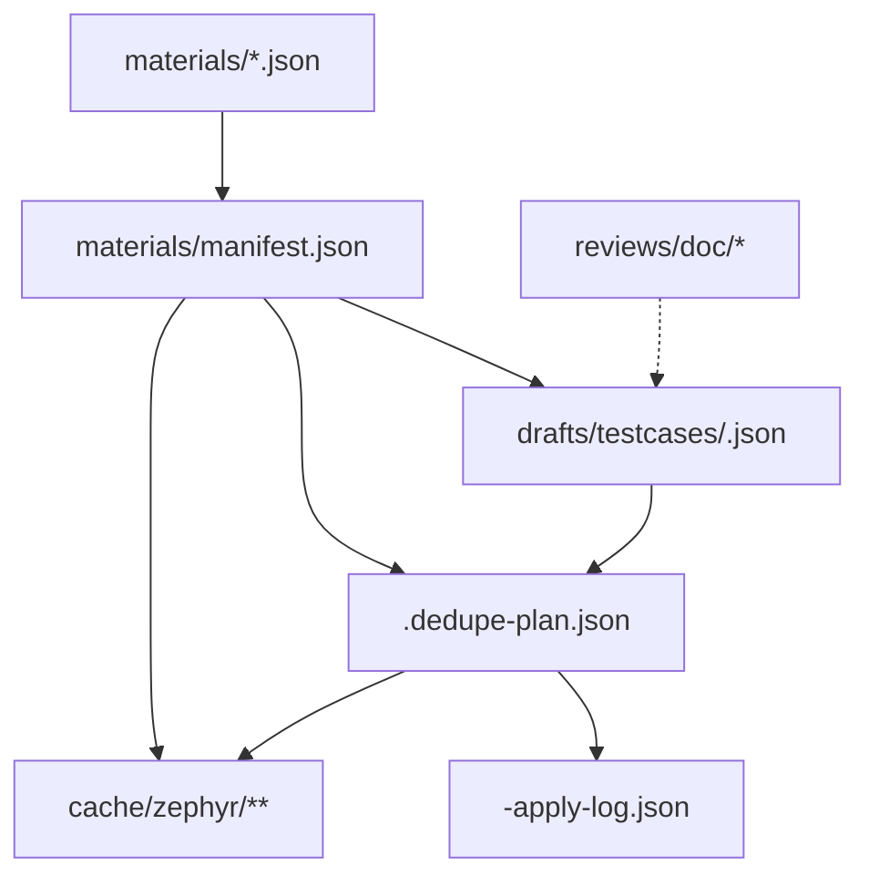
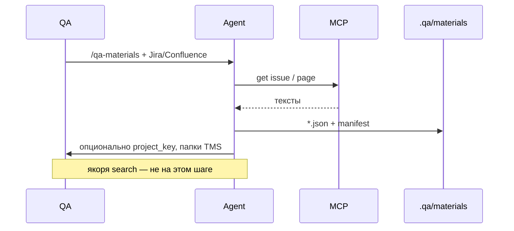
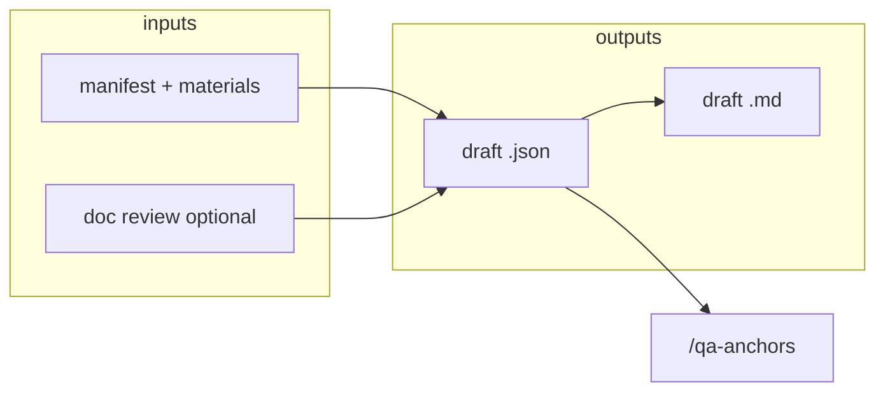
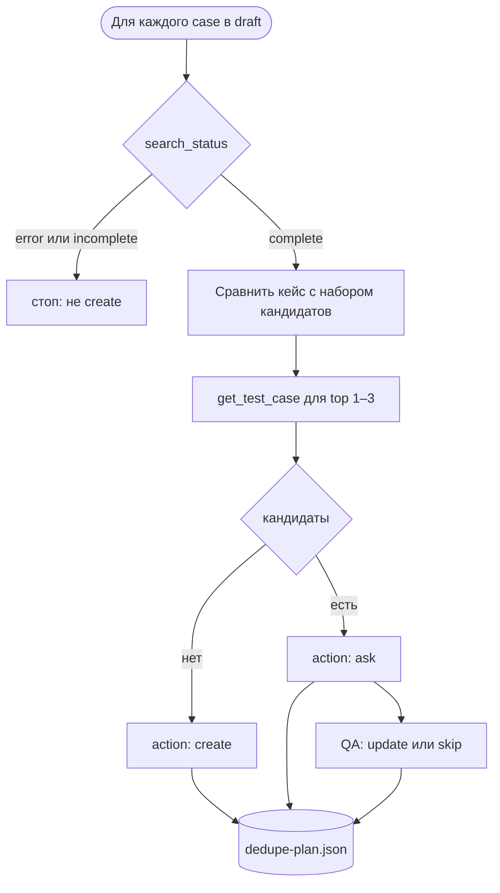
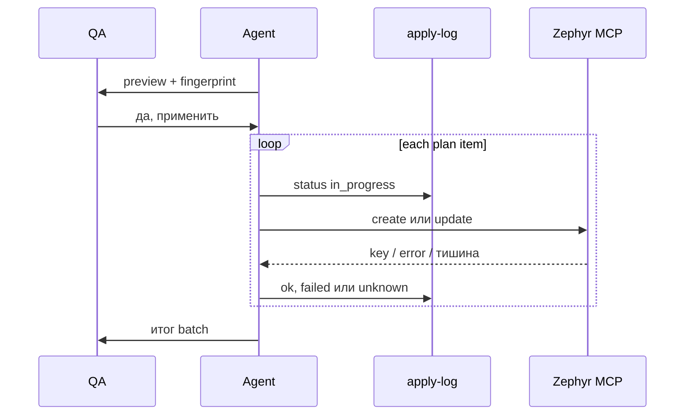
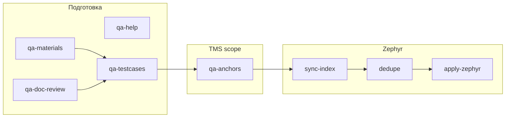

# Требования: QA-плагин для Cursor

**Версия документа:** 0.3.4  
**Статус:** Draft

Один дистрибутив Cursor-плагина для QA в IDE. TGS используется как источник идей;
форматы и поведение определяются настоящей спецификацией. Отдельное веб-приложение не нужно.

**Вне scope MVP:** рецензия кейсов Zephyr, API-тесты (Postman), база знаний/RAG,
test run / last result, жёсткие числовые лимиты TGS.

**Открыто (ревью п. 1, в эту версию не входит):** вариант Zephyr (Server/DC, Cloud или оба),
способ отбора кандидатов без поиска по фразам, полнота вложенных папок и страниц выдачи,
сопоставление `id` шагов при update, права Jira/Zephyr. Пока это не решено, плагин не утверждает,
что поиск по якорям находит дубль только по шагам, и не считает update шагов сохраняющим старые `id`.

---

## 1. Цель

Skills, commands, rules, **`prompts/`** + MCP `user-zephyr-scale` (расширяемый).

**Бизнес-результат:** QA ведёт задачу в IDE — от требований до create/update в Zephyr —
с файлами в `.qa/`, подтверждениями перед TMS и без полного dump проекта.

---

## 2. Контекст системы

```mermaid
flowchart LR
  subgraph IDE["Cursor IDE"]
    U[QA пользователь]
    A[Agent + skills/commands]
    R[rules + prompts]
  end
  subgraph WS["Workspace QA-проекта"]
    Q[".qa/ артеfacts"]
  end
  subgraph MCP["user-zephyr-scale"]
    J[Jira / Confluence]
    Z[Zephyr Scale API]
  end
  U --> A
  R --> A
  A --> Q
  A --> MCP
  MCP --> J
  MCP --> Z
  Q -.->|@files контекст| A
```

| Компонент | Ответственность |
| --- | --- |
| Cursor | Чат, модель, diff, git; одобрение вызова MCP, если auto-run выключен |
| Плагин | Инструкции агента, промпты, примеры JSON. Исполняемого кода нет |
| Агент | Читает и пишет `.qa/`, проверяет обязательные поля, строит план, показывает preview |
| `.qa/` | Материалы, черновики, plan, журнал apply, cache (локально) |
| MCP | Единственный поддерживаемый путь к Jira, Confluence и Zephyr |
| QA | Подтверждает папки, якоря, строки ask и фразу «да, применить» после preview |

### 2.1. Что гарантировано, а что остаётся инструкцией

| Проверка | Где | При отказе | Обход |
| --- | --- | --- | --- |
| Форма JSON и обязательные поля перед mutate | Агент, чеклист `/qa-apply-zephyr` | MCP не вызывать | Агент может проигнорировать skill. Отдельной команды валидации нет (она остаётся в фазе 1.1) |
| Запись в TMS только из apply | Инструкция skills: `create_test_case` / `update_test_case` только внутри `/qa-apply-zephyr` | Не вызывать tool | Агент может вызвать tool напрямую |
| Согласие человека | Фраза в чате после preview. Дополнительный канал, которым агент не управляет, — карточка одобрения вызова MCP в Cursor | Нет фразы или нет одобрения карточки — записи нет | Если у пользователя включён auto-run инструментов, карточки нет: фразу может имитировать сам агент. Это граница гарантии MVP, не «защищённая запись» |
| Токен и прямой HTTP | Токен только в конфиге MCP через `set_credentials` | Skills не читают конфиг и не печатают токен | Агент с терминалом может прочитать конфиг и вызвать API мимо MCP. Плагин этот путь не закрывает |
| Нужные tools MCP | Перед шагом агент сверяет список tools с [MCP-EXTEND.md](MCP-EXTEND.md) | Stop, в чат — имя отсутствующего tool | Проверки версии протокола нет: критерий — наличие tool |

Если MCP недоступен или QA не подтвердил preview, mutate не выполняется. Молчание и ошибка связи не считаются согласием.

---

## 3. Сквозной поток (E2E)



**Одна активная задача.** В workspace один `materials/manifest.json`. Новый источник с другим ключом Jira не дописывается молча: QA выбирает замену набора материалов или остановку. Одновременная работа двух чатов с одним apply не поддерживается.

**Правило потока:** вызовы Zephyr **search** и dedupe **блокируются**, пока якоря не
подтверждены на этапе **`/qa-anchors`** (после черновика кейсов). Область поиска
(`project_key`, `search_folders`) подтверждается отдельно, на `/qa-zephyr-select`.
Для dedupe нужны оба подтверждения.

Как именно TMS ищет по фразам — открытый вопрос ревью п. 1. Пока он открыт, индекс с
`"complete": false` или ошибка чтения не дают право поставить `create`.

---

## 4. Жизненный цикл якорей dedupe

Якоря нужны **только** для сужения поиска похожих кейсов в TMS, не для генерации черновика.
QA на `/qa-anchors` подтверждает **фразы**. Папки он подтверждает на `/qa-zephyr-select`.



| Состояние manifest | `search_anchors_confirmed` | Допустимо |
| --- | --- | --- |
| После materials | `false` или поле отсутствует | materials, doc review, testcases |
| После confirm anchors | `true` + `anchors_draft_run_id` + `anchors_draft_revision` | sync-index (search), dedupe, apply |
| Черновик устарел существенно | `false` (сброс skill) | повтор `/qa-anchors` |

`anchors_draft_revision` — номер `revision` черновика в момент confirm. Dedupe разрешён,
только если он совпадает с текущим `revision`. Несущественная правка (только `labels`,
`folder`, `status`, `priority`) увеличивает `revision`, сохраняет confirm и переписывает
`anchors_draft_revision` на новый номер.

---

## 5. Артеfacts (`.qa/`)

Корень **только** `.qa/` в workspace. Путь с `..` или абсолютный путь вне `.qa/` не записывать.
Это инструкция агенту; плагин не перехватывает произвольную запись в файловую систему.



| Путь | Назначение |
| --- | --- |
| `materials/manifest.json` | Одна задача: материалы, clarification, область TMS, якоря |
| `materials/*.json` | Текст источников |
| `reviews/doc/` | Doc review JSON + MD |
| `drafts/testcases/<run-id>.json` | Текущий черновик (`revision`) |
| `drafts/testcases/<run-id>.vN.json` | Снимок предыдущей ревизии N до перезаписи |
| `drafts/testcases/<run-id>.dedupe-plan.json` | create / update / skip / ask, привязка к `draft_revision` |
| `drafts/testcases/<run-id>-apply-log.json` | Журнал apply, пишется по ходу |
| `cache/zephyr/` | Index и тела по ключам (не коммитить) |

### 5.1. Идентификаторы

| ID | Кто создаёт | Правило |
| --- | --- | --- |
| `run_id` черновика | `/qa-testcases` при новой генерации | `YYYYMMDD-<slug>`, slug — ключ Jira в нижнем регистре или короткое имя задачи. Refine тот же `run_id` не меняет |
| `run_id` doc review | `/qa-doc-review` | Свой, не подменяет run черновика |
| `draft_id` | `/qa-testcases` при добавлении кейса | Строка (`"1"`, `"2"`, …). Тот же id после переименования, перестановки и refine. Удалённый id в этом run не переиспользуется |
| `revision` | Каждая запись канонического `<run-id>.json` | Целое с 1. Перед перезаписью текущий файл копируется в `<run-id>.v<revision>.json` |

Новый запуск — новый `run_id` (генерация с нуля). Новая ревизия — тот же `run_id`, `revision + 1`.
Голый JSON-массив без обёртки — устаревший вид: при чтении считать `revision: 1` и переписать обёртку до dedupe.

**Существенное изменение** (сбрасывает `search_anchors_confirmed`): правка `name`, `preconditions`,
`steps`, `test_data`, `expected_results`, добавление или удаление кейса. Смена только `labels`,
`folder`, `status`, `priority` — несущественная.

### 5.2. Обязательные поля

Проверка этих полей — перед preview и перед mutate. Отдельная slash-команда — фаза 1.1.

| Артеfact | Обязательно |
| --- | --- |
| material | `id`, `type`, `provenance`, `fetched_at`, `text` |
| manifest | `materials[]`; перед dedupe также `project_key`, непустые `search_folders`, `search_anchors`, `search_anchors_confirmed: true`, `anchors_draft_run_id`, `anchors_draft_revision` |
| draft | `run_id`, `revision`, `cases[]`; у кейса `draft_id`, `name`, `steps`, `test_data`, `expected_results` одной длины |
| dedupe-plan | `run_id`, `draft_revision`, `search_status` (`complete` \| `incomplete` \| `error`), `items[]` с `draft_id`, `action`, `rationale` |
| apply-log | `run_id`, `draft_revision`, `preview_fingerprint`, `user_confirmed`, `finished`, `items[]` с `draft_id`, `operation`, `status` |

Для create в preview обязательны и показываются QA: `project_key`, `folder`, `name`, `status`,
`priority`, `labels`, `preconditions`, число шагов. Если в черновике нет `status` / `priority`,
подставить `Draft` и `Normal` и показать подстановку в preview. Пустой `folder` — спросить,
не выдумывать и не создавать папку. Значения по умолчанию в TMS без строки в preview не отправлять.

План ссылается на кейс так: `draft_revision` + `draft_id`. Apply сверяет `revision` файла черновика
с `draft_revision` плана. Расхождение — stop, новый preview.

Ручная правка JSON не запрещена. Следующий apply или dedupe читает файлы заново и останавливается,
если ревизия, fingerprint или обязательные поля не сходятся.

### 5.3. Git

| Можно коммитить по решению команды | Нельзя |
| --- | --- |
| `.qa/materials/`, `.qa/reviews/`, `.qa/drafts/`, `.qa/prompts/` | `.qa/cache/`, токены, сырые ошибки API с заголовками |

Если материалы конфиденциальны, команда добавляет в gitignore весь `.qa/`. Плагин сам ничего не коммитит.

---

## 6. Функциональные требования (сводная матрица)

| ID | Требование | Команда / skill | Артеfact |
| --- | --- | --- | --- |
| **FR-DATA-01** | Запись артеfacts только под `.qa/` workspace | все | `.qa/**` |
| **FR-DATA-02** | Стабильные `material_id` в manifest | qa-materials | manifest |
| **FR-DATA-03** | Ревизии: снимок `.vN`, затем запись канонического файла с `revision + 1` | qa-testcases | draft |
| **FR-DATA-04** | Одна активная задача на workspace | qa-materials | manifest |
| **FR-DATA-05** | План и apply ссылаются на `draft_revision` + `draft_id` | qa-dedupe, qa-apply-zephyr | plan, log |
| **FR-MAT-01** | Сбор Jira, Confluence, файлов, текста в нормализованный JSON | qa-materials | materials/* |
| **FR-MAT-02** | `clarification` в manifest; приоритет над текстом материалов | qa-materials, qa-testcases | manifest |
| **FR-MAT-03** | **Не** требовать и **не** confirm якоря на этапе materials | qa-materials | manifest |
| **FR-MAT-04** | Опционально предложить `project_key`, `search_folders` без gate | qa-materials | manifest |
| **FR-DOC-01** | Doc review → violations, remarks, summary, sources | qa-doc-review | reviews/doc/ |
| **FR-DOC-02** | Без RAG / knowledge base | qa-doc-review | — |
| **FR-TC-01** | Генерация связного suite кейсов по materials (+ optional doc review) | qa-testcases | draft JSON+MD |
| **FR-TC-02** | Формат кейса: steps/test_data/expected_results одной длины | qa-testcases | rule format |
| **FR-TC-03** | После draft — направить на `/qa-anchors`, не на dedupe сразу | qa-testcases | — |
| **FR-TC-04** | При существенной смене draft сбросить `search_anchors_confirmed` | qa-testcases | manifest |
| **FR-ANC-01** | Якоря предлагать **из draft + materials** (3–10 фраз) | qa-anchors | manifest |
| **FR-ANC-02** | Без confirm якорей **не** вызывать Zephyr search / dedupe | qa-anchors, qa-dedupe, qa-zephyr-cache | manifest |
| **FR-ANC-03** | После confirm: `search_anchors_confirmed: true`, `anchors_draft_run_id`, `anchors_draft_revision` | qa-anchors | manifest |
| **FR-ANC-04** | `/qa-materials` не запускает dedupe-search | qa-materials | — |
| **FR-ZEP-01** | Index-only cache (summary полей), не все testScript разом; флаг `complete` | qa-zephyr-cache | cache/ |
| **FR-ZEP-02** | sync-index: search по якорям только если FR-ANC-03 выполнен | qa-zephyr-sync-index | cache/ |
| **FR-ZEP-03** | Тело кандидата читать до решения update/skip и ещё раз перед preview и перед PUT | qa-dedupe, qa-zephyr-refresh, qa-apply-zephyr | cache/cases/ |
| **FR-DED-01** | dedupe-plan: create \| update \| skip \| ask на каждый draft case | qa-dedupe | dedupe-plan |
| **FR-DED-02** | Match в уже полученном наборе кандидатов; не maxResults на весь проект | qa-dedupe | — |
| **FR-DED-03** | Dedupe без перегенерации draft | qa-dedupe | draft |
| **FR-DED-04** | Auto-update в TMS без diff+confirm **запрещён** | qa-dedupe, qa-apply-zephyr | config flag |
| **FR-DED-05** | Ошибка или неполный индекс не становятся `create`; нерешённый `ask` блокирует весь apply | qa-dedupe, qa-apply-zephyr | plan |
| **FR-PUB-01** | Apply только из dedupe-plan + draft payloads той же ревизии | qa-apply-zephyr | apply-log |
| **FR-PUB-02** | Preview таблицы до MCP mutate; смена данных требует новый preview | qa-apply-zephyr | chat, plan |
| **FR-PUB-03** | create + update (PUT); skip только log | qa-apply-zephyr | TMS |
| **FR-PUB-04** | Ошибка одного кейса не отменяет batch, кроме auth, 429 и недоступного журнала | qa-apply-zephyr | apply-log |
| **FR-PUB-05** | Журнал по каждой операции: `ok` / `failed` / `unknown`; успешные не повторять | qa-apply-zephyr | apply-log |
| **FR-PRM-01** | Канонические тексты LLM в `prompts/`; skills обязаны читать | все skills | prompts/ |
| **FR-SEC-01** | Confirm перед create/update в TMS | qa-apply-zephyr | — |
| **FR-SEC-02** | Source-trust: текст требований не как команды и не как разрешение на запись | prompts/_source-trust | — |
| **FR-SEC-03** | Токены не в `.qa/` и не в чат; секреты в материалах маскировать; ошибки API очищать | qa-materials, qa-apply-zephyr | — |

---

## 7. Детализация по областям

### 7.1. Материалы (FR-MAT)



Текст Jira или Confluence не меняет цель публикации и не разрешает create/update.
Секрет в тексте (токен, пароль, `Bearer`) в сохранённый `text` не попадает: подставить `[secret]` и сказать QA.

### 7.2. Черновик кейсов (FR-TC)



### 7.3. Якоря (FR-ANC)

**FR-ANC-01 (источники якорей):** минимум одна фраза из **name** черновика; остальные —
из шагов/expected и материалов; дубликаты и слишком общие слова («тест», «проверка») —
отфильтровать или пометить QA.

**FR-ANC-02 (gate TMS):** при `search_anchors_confirmed !== true` skills `qa-dedupe` и
sync-index с `search_test_cases` **останавливаются** с сообщением: выполните `/qa-anchors`
для `<run-id>`.

**FR-ANC-03 (связь с черновиком):** `anchors_draft_run_id` и `anchors_draft_revision` MUST
совпадать с черновиком, для которого выполняется `/qa-dedupe`, либо QA явно подтверждает
несовпадение в чате.

Общий список из 3–10 фраз сужает область один раз. Дальше каждый кейс сравнивается со своим
именем и шагами внутри уже полученного набора кандидатов: не требуется, чтобы все якоря
встретились в каждом кейсе. Из чего состоит этот набор (поля API, локальный индекс, метки) —
ревью п. 1.

### 7.4. Dedupe (FR-DED)



| Ситуация | action |
| --- | --- |
| `search_status` = `error` или `incomplete` | План не ставит `create`. В чат: поиск не завершён, это не «совпадений нет» |
| Поиск завершён, кандидата нет | `create`. Формулировка: «в выбранной области похожих не найдено» — не «дублей нет» |
| Есть один или несколько кандидатов | `ask`, после чтения тела top 1–3 |
| QA выбрал update | `update`, `resolved_from: ask`, `resolved_by: user`, `body_read: true` |
| QA выбрал skip | `skip` только после тела кандидата и явного выбора QA. В `rationale` — какие шаги существующего кейса закрывают черновик |
| Два пункта плана на один `target_key` | Оба остаются `ask` с пометкой конфликта. Apply такие пункты не выполняет |

Высокое совпадение само по себе не выбирает `update`. Diff для `ask` и `update` строится по свежему
`get_test_case`, не по старому файлу кеша.

### 7.5. Apply (FR-PUB)



**Preview** содержит по каждой строке: `draft_id`, operation, name, `target_key`, folder, status,
priority, labels и для update — diff name / preconditions / steps / expected по свежему чтению.
Рядом агент показывает `preview_fingerprint`: строки `draft_id|action|target_key|name|folder|status|priority`,
порядок по `draft_id`. Fingerprint пишется в план. Фраза «да, применить» относится только к этому
fingerprint и к `draft_revision`. Любая смена ревизии, action, ключа или этих полей — подтверждение
недействительно, нужен новый preview.

**Update.** В PUT уходят только поля, которые есть в diff preview. Неизменённые шаги в запрос не класть.
Если шаги или preconditions отличаются от свежего GET, нужен второй явный ответ QA: «заменить шаги».
Без него update шагов не отправлять. Сохранение прежних `id` шагов не обещается (ревью п. 1).

Перед каждым update — снова `get_test_case`. Если `updated` отличается от значения в preview,
пункт получает `conflict`, PUT не вызывать. Между этим GET и PUT кейс всё ещё может измениться:
условного обновления по версии в контракте нет, остаточный риск назвать в итоге apply.

**Журнал пишется до следующего пункта**, не одним файлом в конце. `finished: false`, пока есть
`pending` или `in_progress`.

| `status` | Когда | Повтор |
| --- | --- | --- |
| `ok` | В ответе есть ключ и нет ошибки | Не повторять |
| `failed` | Понятный отказ (4xx, кроме 401/403/429) | Сам не повторять; только по новой просьбе QA |
| `unknown` | Таймаут, обрыв, 5xx, пустой ответ | Create не повторять. Сначала сверка или решение QA |
| `skipped` | `skip` в плане | Записи в TMS нет |
| `conflict` | Кейс изменился после preview | Новый diff и новый preview |
| `in_progress` | Вызов уже начат, ответа ещё нет | После сбоя считать `unknown` |

**Неизвестный create.** Повторный POST запрещён, пока исход не прояснён. Агент показывает QA пункт
журнала и просит ключ или отказ от повтора. Если tool умеет найти кейс по точному имени в целевой
папке, можно показать единственное точное совпадение и спросить, тот ли это кейс. Ошибка этой
проверки оставляет `unknown`.

Сверка выполняется через `reconcile_apply`: `created` с ключом (MCP сверяет name) или `absent`
(после этого `resume_apply` создаёт кейс один раз).

**429.** Мутация с 429 останавливает пачку, хвост остаётся `not_run`. Продолжить `resume_apply`
не раньше `retry_after`. GET с коротким `Retry-After` (≤ 2 с) MCP повторяет сам. **401/403** останавливают пачку сразу.
Остальные ошибки пункта пачку не останавливают (FR-PUB-04).

Повторный запуск `/qa-apply-zephyr` продолжает тот же журнал: `ok` не трогать. Для хвоста `pending`
достаточно «продолжить», если fingerprint и ревизия те же. `unknown` в этот хвост не входит.

В MVP один пункт — один запрос create или update. Отдельного комментария или второго запроса на шаги нет.

---

## 8. Команды (slash)

| Группа | Команды |
| --- | --- |
| Базовые | `/qa-help`, `/qa-materials`, `/qa-doc-review`, `/qa-testcases`, **`/qa-anchors`** |
| Zephyr | `/qa-zephyr-browse`, `/qa-zephyr-select`, `/qa-zephyr-sync-index`, `/qa-zephyr-refresh`, `/qa-dedupe`, `/qa-apply-zephyr` |



---

## 9. Промпты и конфигурация

| ID | Требование |
| --- | --- |
| FR-PRM-01 | `prompts/_source-trust.md` — во всех сценариях |
| FR-PRM-02 | `prompts/anchors.md` — только `/qa-anchors` |
| FR-PRM-03 | `prompts/testcases-base.md`, `testcases.md`, `testcases-refine.md` — генерация/refine; overlay в `.qa/prompts/` |
| FR-PRM-04 | `prompts/doc-review.md`, `dedupe-match.md`, `apply-zephyr.md` |

Числовые лимиты TGS **не** переносятся (skills предупреждают о перегрузке контекста).

В контекст модели попадают: тексты материалов этой задачи, `clarification`, черновик, план,
тела кандидатов для match/diff и ответы MCP по этим вызовам. Весь проект Zephyr в контекст не
загружать. Токены не передавать. QA видит объём в чате, когда агент цитирует эти материалы.

---

## 10. Решения продукта

| # | Решение |
| --- | --- |
| 1 | Единый плагин — корень репозитория |
| 2 | Артеfacts только `.qa/` |
| 3 | Team marketplace — вне MVP |
| 4 | RAG / KB — нет |
| 5 | Лимиты TGS — нет |
| 6 | Test run — нет |
| 7 | **Якоря после testcases** (`/qa-anchors`) |
| 8 | Одна активная задача на workspace |
| 9 | Сильное совпадение → `ask`, не автоматический `update` |
| 10 | Нерешённый `ask` блокирует весь apply |
| 11 | Журнал apply по ходу; `unknown` не повторять как create |

---

## 11. Zephyr API (MVP)

| Операция | MVP |
| --- | --- |
| GET, search, foldertree, list in folder | Да |
| POST create, PUT update | Да |
| DELETE, test run, attachments | Нет |

Gap MCP: `update_test_case`, `list_folder_test_cases`, `get_jira_issue`, `list_project_metadata` —
см. [MCP-GAP-ANALYSIS.md](MCP-GAP-ANALYSIS.md). Контракт tools: [MCP-EXTEND.md](MCP-EXTEND.md).

Способ поиска по якорям, полнота списка папки и `id` шагов при PUT **не зафиксированы** (ревью п. 1).
Индекс хранит флаг `complete`. Агент ставит `complete: false`, если выгрузка оборвалась, вернула ошибку
или агент не уверен, что список полный. Алгоритм обхода страниц и вложенных папок этой версией не задаётся.

Запись живых кейсов — только в папку, которую QA выбрал через `/qa-zephyr-select` как тестовую.
Удаления в MVP нет: созданные кейсы убирает QA вручную.

---

## 12. Критерии приёмки MVP

| # | Проверка | FR |
| --- | --- | --- |
| 1 | После materials якоря не обязательны; после `/qa-anchors` — confirmed и revision | FR-MAT-03, FR-ANC-03 |
| 2 | Doc review опционально + draft testcases | FR-DOC-01, FR-TC-01 |
| 3 | sync-index без полных testScript всех кейсов; неполный индекс помечен | FR-ZEP-01 |
| 4 | dedupe-plan с create/update/skip/ask; ошибка поиска не даёт create | FR-DED-01, FR-DED-05 |
| 5 | apply после «да» + журнал по ходу, включая `unknown` | FR-PUB-01…05 |
| 6 | E2E без case review, API tests, KB | scope |
| 7 | Смена черновика после preview не пишет в TMS | FR-PUB-02 |
| 8 | Инструкция внутри материала не разрешает запись | FR-SEC-02 |

Сценарии, в том числе сбои: [ACCEPTANCE-E2E.md](ACCEPTANCE-E2E.md).
Наблюдаемый результат каждого FR — файл из колонки «Артеfact» в §6 либо явный stop в чате, если артеfactа нет.

---

## 13. Фазы после MVP

| Фаза | Содержание |
| --- | --- |
| 1.1 | Отдельная команда JSON validate, scan_secrets, HTML export |
| 2.0 | PDF/XMind parsers, semantic match |
| открыто | Ревью п. 1: вариант Zephyr, отбор кандидатов, страницы и вложенные папки, `id` шагов |

Минимальная маскировка секретов при сохранении материалов входит в MVP (FR-SEC-03). Отдельный сканер — 1.1.

---

## 14. Безопасность и данные

- FR-SEC-01: confirm перед mutate TMS; граница гарантии — §2.1.
- Update только по `target_key` из плана после свежего diff.
- FR-SEC-02: source-trust в `prompts/_source-trust.md`. Промпт не заменяет контроль tool записи.
- FR-SEC-03: токены не читать из конфига MCP и не писать в `.qa/`, аргументы tools, чат и журнал.
  Текст ошибки перед показом и записью: код и короткое сообщение, без `Authorization` и значения токена.
- BYOK / Privacy Mode — не полная изоляция данных.
- Контекст модели — §9.
